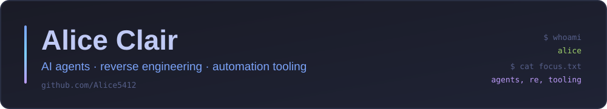

  

## 📊 My Stats

<picture>
  <source media="(prefers-color-scheme: dark)" srcset="./profile/github-snake-dark.svg" />
  <source media="(prefers-color-scheme: light)" srcset="./profile/github-snake.svg" />
  
</picture>

## 🧰 Stack

## 🚀 Selected Work

| 项目 | 说明 |
| --- | --- |
| **[catbus](https://github.com/cv-cat/catbus)** | 一套命令操作小红书、抖音、TikTok、B 站、快手、微博、闲鱼、淘宝、京东、X，统一 JSON 输出，给人和 AI Agent 用 |
| **[claude-reverse-skills](https://github.com/Alice5412/claude-reverse-skills)** | Claude Code 逆向工程 skill 集合（APK / IDA / radare2 / JS），含 IDA MCP 接入，跨 Linux / macOS / Windows |
| **[codex-session-toolkit](https://github.com/Alice5412/codex-session-toolkit)** | Windows 工具，按工作目录浏览本地 Codex 会话，从任意用户轮次 fork，切换账号，跨账号迁移对话 |
| **[qwen-free-api](https://github.com/Alice5412/qwen-free-api)** | 用 Selenium 驱动浏览器，把通义千问网页版封装成 OpenAI 兼容 API |
| **[my-neuro](https://github.com/Alice5412/my-neuro)** | 可自定义角色与语音的 AI 桌面伴侣，支持长期记忆、视觉识别、声音克隆 |

Stats, trophies and the snake are rendered by GitHub Actions and committed as SVG.

